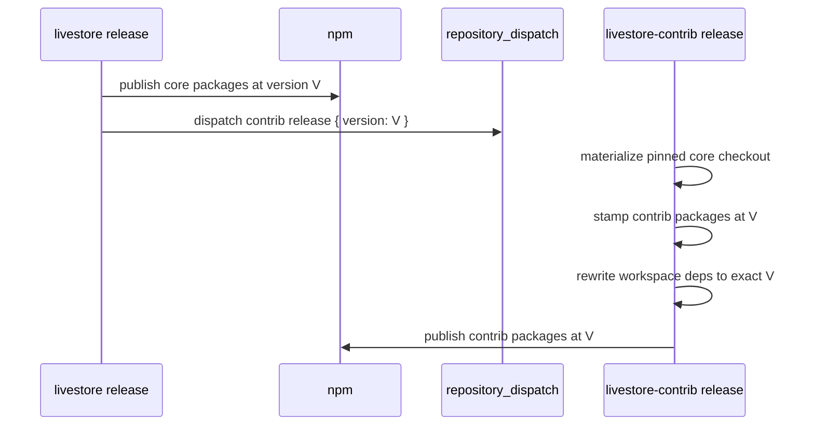

# Delivery Release — Spec

This document specifies the release flow across the two repositories. It
builds on [requirements.md](./requirements.md). Step-by-step operator
procedures live in the companion runbooks
([package-release-runbook.md](./package-release-runbook.md),
[release-workflows-runbook.md](./release-workflows-runbook.md),
[dependency-management.md](./dependency-management.md)); this spec owns the
contract they realize.

## Status

Draft — the lockstep release contract below is active; a first contrib
release has not yet exercised it (LS.DEL.REL-DQ1).

## Scope

Defines: publish-time dependency resolution, the lockstep release flow, and
dependency-update policy ownership. Does not define: workspace composition
([../01-composition/](../01-composition/spec.md)) or artifact flows
([../03-artifacts/](../03-artifacts/spec.md)).

## Publish-Time Dependency Resolution

Contrib release manifests replace `workspace:*` dependencies on core
packages with the exact core version being published (LS.DEL.REL-R02):

```json
{
  "dependencies": {
    "@livestore/framework-toolkit": "0.4.2",
    "@livestore/livestore": "0.4.2"
  }
}
```

No contrib package publishes a range dependency on a core package. Exact
versions make a published release graph deterministic for users.

## Release Flow



Manual contrib release dispatch accepts an explicit version but must use a
version already published by core (LS.DEL.REL-R05).

## Stable and Main-Snapshot Publish Containment

Stable releases use `prepare-release` → `validate-release` → `publish-release`
→ `finalize-release`. Main snapshots use `prepare-snapshot-version` →
`validate-snapshot-version` → `publish-snapshot-version`. The pull-request
snapshot promotion contract below remains separate and unchanged.

Preparation builds and packs core packages and repacks the selected DevTools
artifact without npm publish authority. Stable preparation also runs the existing
release-candidate liveness certification. Core packing uses
`mono release artifact-pack --version "$VERSION" --npm-tag "$TAG" --out-dir "$OUT"`.
The prepared `release-artifact` directory contains `manifest.json` and the exact
tarballs for the release topology plus `@livestore/devtools-vite`. The manifest
has `schemaVersion: 1`, `sourceSha`, `version`, `npmTag`, and `packages` records
with `name`, `version`, `filename`, `integrity` (SHA-512 SRI), and `tag`. The
DevTools tag follows its existing `publishTagForVersion` policy. The directory
may also contain the Chrome ZIP and `release-notes.md` for finalization.

Validation runs separately without secrets or OIDC authority. It checks the
manifest, source identity, expected package cohort, package names and versions,
tags, digests, and publishConfig policy. Decompression is bounded to 512 MiB.
System `tar` lists canonical entries under `package/` and reads only the single
`package/package.json` member to stdout, without filesystem extraction or
package-code execution; each invocation has a 60-second timeout. Aliased paths
and entries outside `package/` fail validation. Publication consumes the validated tarballs
without repository checkout, dependency installation, building, `mono`, or
package lifecycle scripts. The npm-credentialed boundary contains only shell
orchestration and `npm publish --ignore-scripts --provenance`; it rechecks byte
integrity and accepts an already-published version only when registry integrity
matches. Stable finalization handles GitHub Release metadata and Chrome assets
outside the npm-credentialed job.

This is credential containment, not a proof of benign build output. Hashes bind
the bytes passed between jobs and detect a changed handoff. A malicious prepare
or build can still create malicious tarballs with matching hashes. Reviewed
source, build dependencies, and preparation remain trusted inputs to publication.

## Stable Production Surface Promotion

Package and DevTools artifact publication runs from `main`. Production docs,
examples, and search run separately from the reviewed `docs/stable` branch.
For each successful `latest` release, a maintainer opens a PR advancing
`docs/stable` to the exact published release commit, preserving applicable
stable-only documentation fixes. The merged branch must identify the published
stable version; it is not advanced for prereleases or snapshots.
Promotion PR validation is scoped by the PR base ref: `docs/stable` checks every
release-topology package's published version and `latest` dist-tag, and proves
that the published `v<version>` tag's commit is an ancestor of the exact PR
head. It uses the checked-in stable plan without synthesizing a prerelease.
PRs against `main` retain the unpublished-package rehearsal.

The maintainer dispatches `deploy-prod.yml --ref docs/stable` for docs, then
examples and search from the same recorded, unchanged stable SHA. Search must
follow successful docs deployment, including verification and CDN purge; the
workflow enforces this ordering for `target=all`. Every production target
rejects other refs. Stable-only docs backports are reviewed against this branch
and deployed with the same docs/search sequence.

This explicit approval boundary preserves the stable baseline established in
[#1637](https://github.com/livestorejs/livestore/pull/1637), rather than coupling
production docs to a moving development head or automatically advancing a
branch with stable-only fixes. Commands and recovery:
[release-workflows-runbook.md](./release-workflows-runbook.md).

## Pull-Request Snapshot Promotion (LS.DEL.REL-R08)

```text
pull_request CI (untrusted)             release.yml on main (trusted)
----------------------------------      --------------------------------
pack exact PR head without secrets ---> resolve exact repo/branch/SHA run
upload immutable candidate              validate bounded package cohort
                                        re-read open PR + current head
same-repo PR: current-head approval ---> authorize
fork PR: ci:publish-snapshot label ----> authorize while label remains
                                        recheck immediately before npm OIDC
                                        publish exact-SHA immutable versions
```

The `pack-pr-snapshot` job runs for every pull request, including forks, with
`contents: read`, no npm authority, and no CACHIX credential. Its artifact is
untrusted data. The trusted main-branch workflow downloads but never executes
the candidate, validates its exact package topology, version, dependency pins,
paths, sizes, lifecycle-script absence, and digests, and publishes tarballs with
scripts disabled.

GitHub Actions may omit fork PR associations from workflow-run records. The
publisher therefore identifies a producer by the exact tuple of head repository,
head branch, and head SHA, requires it to resolve to exactly one open non-draft
PR targeting `main`, and binds the manifest to that PR number and run attempt.

Repository-owned PR authorization remains the authoritative review decision plus
an approval naming the current head. For a fork PR, the persistent
`ci:publish-snapshot` label trusts control of that PR's mutable head repository
and branch: later commits remain eligible while the label is present. Removing
the label cancels any candidate whose npm publication has not started. Published
npm versions are immutable and are not revoked by removing the label. Decision
and rejected alternatives: [.decisions/0002](./.decisions/0002-fork-snapshot-trust-label.md).

The job graph and the candidate validator are shared rather than local to this
repository: both are supplied by `effect-utils` and consumed here and by
livestore-contrib, so the rules deciding what may be published are one
implementation rather than two that can drift. The validator is emitted from
that shared source, so the two repositories agree on the bytes that gate
publication. Decision and rejected alternatives:
[.decisions/0003](./.decisions/0003-share-the-pr-snapshot-pipeline.md).

## Breaking-Change Mechanics (LS.DEL.REL-R06)

Beta releases may break in three distinct ways (user-facing promise:
`../../01-product/spec.md` §Maturity & Stability Promise):

| Kind                        | Mechanism                                                       | Consequence                                                                              |
| --------------------------- | --------------------------------------------------------------- | ---------------------------------------------------------------------------------------- |
| API                         | public API change in a minor release                            | code migration, guided by release notes                                                  |
| Client storage format       | `liveStoreStorageFormatVersion` bump                            | persisted client state resets (see `02-system/02-state/01-sqlite/02-schema-management/`) |
| Sync backend storage format | provider persistence change (e.g. `PERSISTENCE_FORMAT_VERSION`) | backend soft-reset per provider (see `02-system/03-sync/03-cf/`)                         |

Release notes classify each breaking change by kind and include a migration
path where feasible. The application-facing
[0.4 to 0.5 upgrade guide](../../../docs/src/content/docs/misc/upgrading-0.4-to-0.5.md)
collects the Effect dependency/API migration and deployment implications.

## Dependency-Update Policy

Dependency updates follow the policy documented in
[dependency-management.md](./dependency-management.md) (version ranges,
catalog usage, upgrade cadence). The runbook is operational; changes to the
policy itself are spec changes to this node.

## Ruleset Reconciliation

The `main` branch ruleset is kept converged with its committed desired state
(`.github/repo-settings.json`, whose required-status-check list Genie generates
from the CI job list) by an org-owned GitHub App that applies it.
Decisions and rejected alternatives:
[.decisions/0001](./.decisions/0001-ruleset-reconciliation.md); GitHub platform
limits:
[.reference/github-app-platform-constraints.md](./.reference/github-app-platform-constraints.md);
the manual App lifecycle:
[ruleset-app-provisioning-runbook.md](./ruleset-app-provisioning-runbook.md).

**Identity.** The org-owned reconciler App has `administration: write` and mints
short-lived installation tokens. Its manifest is committed; its private key
(`LIVESTORE_RULESET_APP_KEY`) is an environment secret in `github-admin`, whose
deployment branches are limited to `main`.

**Control flow.** `.github/workflows/repo-settings.yml` runs its `reconcile` job
only on `main`, in `github-admin`: on path-filtered pushes, the scheduled
backstop, or manual dispatch. After checkout without persisted credentials and
token creation, only inline Bash from the code-owned workflow runs: reconcile
fork-PR contributor approval, apply the desired ruleset, then verify managed
fields and fail with a diff on residual drift. The admin-token comparison
includes bypass actors and suppresses GitHub-expanded pull-request defaults.
No Nix/devenv setup, repository scripts, or PR plan job receives the key or token.
Local `github:rulesets:{sync,plan,check}` tasks remain available independently.
Ruleset reconciliation does not affect the `ci` conclusion or gate snapshot
publication.

**App-definition drift.** The workflow deliberately omits the App-definition
drift check, which requires the raw private key and repository TypeScript.
This gap is deferred to the GitHub IaC cutover tracked in
[#1701](https://github.com/livestorejs/livestore/issues/1701).

**App-definition review.** The committed manifest remains the manual provisioning
contract. App permission and event changes are reviewed against the live App
settings UI. The repository CLI no longer accepts the App private key or mints
App JWTs to check `GET /app`. Only the dedicated token-minting action receives
the key; inline ruleset commands receive its scoped installation token instead.

**Ownership.** Each repository owns its `.github/repo-settings.json`; the
privileged workflow lives under code-owned `.github/`.

## Open Design Questions

- **LS.DEL.REL-DQ1 First contrib release proof:** Exercise the contrib
  release workflow with a dry-run or controlled first release before relying
  on it for routine releases.
- **LS.DEL.REL-DQ3 Alchemy `GitHub.App` adoption:** If alchemy ships a
  `GitHub.App` resource ([alchemy-run/alchemy#843](https://github.com/alchemy-run/alchemy/issues/843)),
  the manifest-as-spec + custom drift-check could be replaced by a real resource
  with read/diff built in. Blocked on upstream #843.
- **LS.DEL.REL-DQ4 Parameterize the repo target for contrib enrollment:**
  `scripts/src/commands/github.ts` hardcodes `livestorejs/livestore`, so the
  ruleset tasks only target core; the owner/repo must be parameterized before
  `livestore-contrib` can enroll. Deferred to contrib enrollment.

(LS.DEL.REL-DQ2 was promoted 2026-07-18 to requirement LS.DEL.REL-R07 —
snapshot publishing isolation.)
